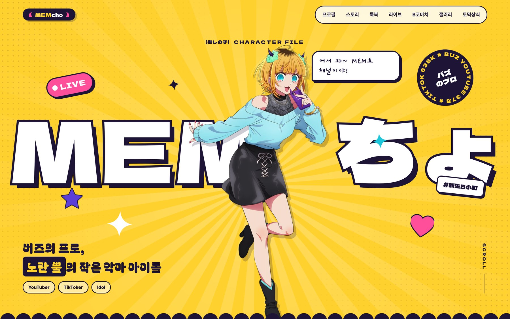
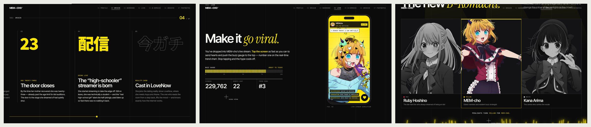
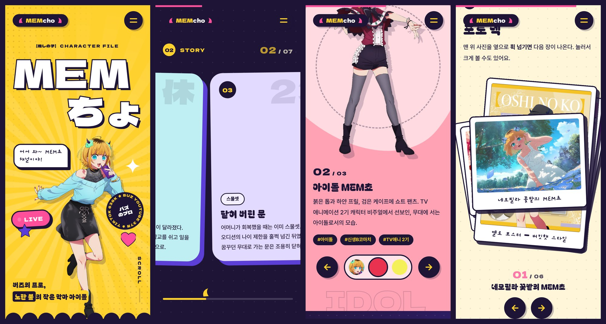

# MEM-cho — Character File

【최애의 아이】의 인기 인플루언서이자 신생 B코마치 멤버 **MEM쵸**를 스크롤·터치·드래그로 알아보는 인터랙티브 팬 페이지입니다.
사이트 본문은 **영문**이고, 빌드 과정 없이 동작하는 정적 사이트(HTML · CSS · JS)입니다.





## 실행

```bash
python3 -m http.server 4173
# → http://localhost:4173
```

정적 파일뿐이라 GitHub Pages(Settings → Pages → 브랜치의 `/ (root)`)에 그대로 올릴 수 있습니다.

## 디자인 — 하이퍼모던

- **색**: 페이퍼(`#EDEDE8`) / 잉크(`#0B0B0C`) 두 가지에, 멤버 컬러에서 가져온 애시드 옐로(`#FFE500`) 하나만 강조색으로 사용
- **타이포**: 꽉 조인 그로테스크(Inter Tight) 대형 헤드라인 + 세리프 이탤릭(Instrument Serif) 대비 + 모노스페이스(JetBrains Mono) 메타 정보
- **그리드**: 모든 섹션에 깔린 6단(모바일 4단) 헤어라인, 인덱스 번호 `(01)`–`(07)`, 십자 마크와 모서리 틱
- **형태**: 모서리 반경 0, 그림자 없음, 1px 선과 면만으로 구성
- **모션**: expo 계열 이징, 단어 단위 마스크 리빌, 클립 와이프, 모노 라벨 스크램블

## 구성과 인터랙션

| 섹션 | 내용 | 인터랙션 |
| --- | --- | --- |
| Hero | 초대형 `MEM CHO` 타이틀, 옐로 디스크, 회전하는 링 텍스트 | 캐릭터 앞뒤로 겹치는 타이틀(면+외곽선 2겹), 마우스·스크롤 패럴랙스, 캐릭터를 누르면 대사 스크램블 |
| (01) Profile | 스펙 표, 대형 수치 | 이미지 클립 와이프, 카운트업, **긁어서 기밀 해제**하는 스크래치 패널(canvas) |
| (02) Origin | 아이돌이 되기까지 7장면과 장면별 이미지 | 세로 스크롤이 **가로 이동**으로 바뀌는 고정(pin) 타임라인, 중앙에 온 패널만 점등(흑백 이미지가 컬러로) |
| (03) Wardrobe | 의상 3종 | 인덱스 목록 · 화살표 · 스와이프로 전환, 컬러 패널 와이프 |
| (04) Live | 방송 화면 목업 | 화면을 연타해 버즈 게이지를 채우는 미니 인터랙션(canvas 파티클) |
| (05) New B-Komachi | 멤버 3인, 주변 인물 | 멤버 선택 시 사이리움 색 변경(비선택 멤버는 흑백), 커서를 따라오는 초상 프리뷰가 있는 아코디언 목록 |
| (06) Archive | 일러스트 6장 | 옆으로 넘기는 **포토 덱**(Draggable), 라이트박스 |
| (07) Footnotes | Q&A 6개 | 아코디언 |

그 밖에 카운터 로더, 좌표를 표시하는 십자 커서, 스크롤 속도에 반응하는 마키, 블렌드 모드 내비게이션, 모바일 전체 화면 메뉴가 들어 있습니다.

## 기술

- [GSAP](https://gsap.com) 3.15 — `ScrollTrigger`(scrub · pin · `containerAnimation` · `batch` · `toggleClass`), `Draggable`, `quickTo`
- [Lenis](https://github.com/darkroomengineering/lenis) 1.3 — 부드러운 스크롤. GSAP ticker로 구동하고 `ScrollTrigger.update`와 동기화
- Canvas 2D — 스크래치 패널, 하트·컨페티 파티클
- 라이브러리는 `assets/js/vendor/`에 포함되어 있어 CDN 없이 동작합니다(웹폰트만 외부 로드).

구현하면서 따른 공식 문서의 원칙:

- 움직임은 `transform` / `opacity` 위주로, 자주 갱신되는 값(마우스 추적)은 `gsap.quickTo`
- 가로 스크롤 트윈은 `ease: "none"`, 고정되는 요소 자체가 아니라 그 안의 트랙을 이동
- ScrollTrigger는 페이지 위→아래 순서로 생성(고정 구간의 간격 계산 때문)
- GSAP이 움직이는 요소에는 CSS `transition: transform`을 쓰지 않음(대신 `translate` / `rotate` / `scale` 개별 속성 사용)
- `prefers-reduced-motion`이면 부드러운 스크롤·패럴랙스·고정 구간을 끄고 세로로 쌓인 정적 레이아웃으로 표시
- 자바스크립트가 꺼져 있어도 모든 내용이 보임

## 폴더

```
index.html
assets/
  css/style.css      스타일
  css/lenis.css      Lenis 기본 스타일
  js/main.js         인터랙션 전체
  js/vendor/         GSAP, ScrollTrigger, Draggable, InertiaPlugin, Lenis
  img/               일러스트(WebP)
docs/                미리보기 이미지
```

## 저작권 안내

비공식 팬 페이지입니다. 원작·애니메이션 제작사와 관계가 없으며, 사용된 일러스트와 캐릭터의 권리는 모두 원저작권자에게 있습니다.
©赤坂アカ×横槍メンゴ／集英社・【推しの子】製作委員会

- 캐릭터 일러스트: [TV 애니메이션 공식 사이트](https://ichigoproduction.com/)의 캐릭터 소개 이미지 및 공식 비주얼
- 설정 참고: 공식 사이트 캐릭터 소개, 위키백과([일본어](https://ja.wikipedia.org/wiki/%E3%80%90%E6%8E%A8%E3%81%97%E3%81%AE%E5%AD%90%E3%80%91) · [영어](https://en.wikipedia.org/wiki/List_of_Oshi_no_Ko_characters))
- GSAP은 [Standard License](https://gsap.com/standard-license), Lenis는 MIT License를 따릅니다.
